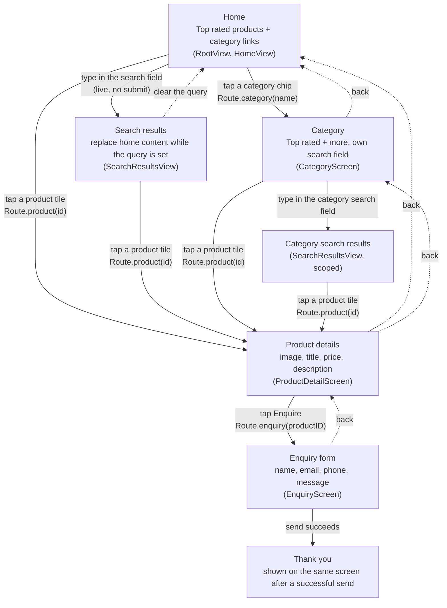

# Screen navigation

How the app's screens connect. Every push goes through one `NavigationStack` in `ios/FakeStoriesChallange/Presentation/Screens/RootView.swift`, and every destination is a `Route` value, so the flow below is the complete set of moves a user can make.

## Flow

Solid arrows are pushes or in-screen changes. Dotted arrows are back moves, handled by the navigation stack (or, for search, by clearing the query).

## Routes

| Route | Pushed by | Destination | Notes |
|---|---|---|---|
| `Route.category(name:)` | Category chip on home | `CategoryScreen` | One view model per visit; loads the category on appear. |
| `Route.product(id:)` | Any product tile: home, category, search results | `ProductDetailScreen` | Loads the product by id on appear. |
| `Route.enquiry(productID:)` | **Enquire** button on the product page | `EnquiryScreen` | Carries the product id so the enquiry is tied to it. |

There is no route for search. Search is a state of the home stack: typing sets `RootView`'s query, and the results replace the home content. Clearing the query brings home back.

## Screen states

| Screen | Loading | Loaded | Empty | Failed |
|---|---|---|---|---|
| Home (featured) | Spinner | Product grid | "No products to show yet." | Offline or server message with **Try again** |
| Home (categories) | Spinner | Category chips | Section hidden | Offline or server message with **Try again** |
| Category | Spinner | Top rated, then more | "No products in this category yet." | Offline or server message with **Try again** |
| Search | Spinner | Product grid | Native "No Results for …" view | Offline or server message with **Try again** |
| Product details | Spinner | Image, text, Enquire | — | Offline or server message with **Try again** |
| Enquiry | — | Form; validation message above the button | — | "We couldn't send your enquiry…" with the entered details kept |

A failed refresh keeps the data already on screen, so going back to a screen shows its previous data straight away.

## Where each piece lives

- `RootView.swift`: the `NavigationStack`, the home search field, and the route-to-screen mapping.
- `HomeView.swift`: category links (`Route.category`).
- `ProductGrid.swift`: product tiles (`Route.product`), used by home, category, and search results.
- `ProductDetailScreen.swift`: the Enquire link (`Route.enquiry`).
- `CategoryScreen.swift`: the category's own search field.
- `Route.swift`: the three route cases.
